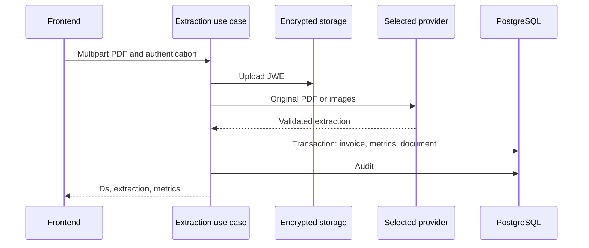

# System Architecture and Flow

Accepts energy-bill PDFs, extracts structured fields through a multimodal provider, calculates metrics and exposes listings, dashboards, documents and administration. Compare results with the original PDF; schema validation does not prove that values were read correctly.

## Implemented behavior

TypeScript/NestJS 11 with Prisma 6.4/PostgreSQL, Passport/JWT, Argon2, Zod, S3 and JWE; Next.js 16.1.6/React 19.2.3 frontend with Redux Toolkit and TanStack Query. auth, invoices, llm, storage, audit, admin and health separate presentation, application and contracts. The use case depends on ILlmExtractor and DocumentStoragePort. Processing is synchronous within the request; this flow has no extraction queue.

## Related files

- [backend/src/modules/invoices/application/process-invoice-extraction.use-case.ts](https://github.com/Vidigal-code/energy-bill-ai-parser/blob/00154f885896b294707fbf12ef0701a3d62630cd/backend/src/modules/invoices/application/process-invoice-extraction.use-case.ts)
- [backend/src/modules/invoices/domain/contracts/invoice-extraction.contract.ts](https://github.com/Vidigal-code/energy-bill-ai-parser/blob/00154f885896b294707fbf12ef0701a3d62630cd/backend/src/modules/invoices/domain/contracts/invoice-extraction.contract.ts)
- [backend/src/modules/llm/llm.module.ts](https://github.com/Vidigal-code/energy-bill-ai-parser/blob/00154f885896b294707fbf12ef0701a3d62630cd/backend/src/modules/llm/llm.module.ts)
- [backend/src/modules/invoices/presentation/invoices.controller.ts](https://github.com/Vidigal-code/energy-bill-ai-parser/blob/00154f885896b294707fbf12ef0701a3d62630cd/backend/src/modules/invoices/presentation/invoices.controller.ts)
- [backend/prisma/schema.prisma](https://github.com/Vidigal-code/energy-bill-ai-parser/blob/00154f885896b294707fbf12ef0701a3d62630cd/backend/prisma/schema.prisma)
- [docker-compose.yml](https://github.com/Vidigal-code/energy-bill-ai-parser/blob/00154f885896b294707fbf12ef0701a3d62630cd/docker-compose.yml)

## Navigation

- [Project guide](?menu=en&lang=en&id=19)
- [Source reference](?menu=en&lang=en&id=20)
