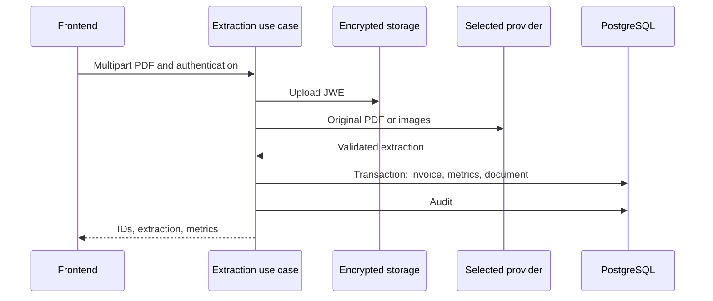

# energy-bill-ai-parser: Project context and workflows

GitPageDocs **0.0.17** · 1.0.0 · 2026-10-29

## Context

Accepts energy-bill PDFs, extracts structured fields through a multimodal provider, calculates metrics and exposes listings, dashboards, documents and administration. Compare results with the original PDF; schema validation does not prove that values were read correctly.

## Stack and architecture

TypeScript/NestJS 11 with Prisma 6.4/PostgreSQL, Passport/JWT, Argon2, Zod, S3 and JWE; Next.js 16.1.6/React 19.2.3 frontend with Redux Toolkit and TanStack Query. auth, invoices, llm, storage, audit, admin and health separate presentation, application and contracts. The use case depends on ILlmExtractor and DocumentStoragePort. Processing is synchronous within the request; this flow has no extraction queue.

## End-to-end workflows

1. Login/registration → access and refresh tokens → JwtAuthGuard/RolesGuard. USER queries its uploaderUserId data; ADMIN has administrative queries. RefreshToken stores hash, jti, expiry, revocation and replacement; refresh is not stateless. The controller inventory lists actual routes.

2. POST /api/invoices/extract accepts multipart field file. Missing file returns 400, non-application/pdf MIME 415 and size above PDF_MAX_FILE_SIZE_MB 413. The file is encrypted as JWE and uploaded to S3 before extraction. The use case's MIME check is not complete content inspection.

3. OPEN_SOURCE_IA=true selects Ollama; otherwise LLM_PROVIDER selects openai (default), gemini/google or claude. The module uses HTTP adapters, not a required Gemini SDK. Providers validate output against a shared contract; Ollama converts PDF to images. Model/endpoint come from configuration. ROLLBACK_ON_INVOICE_FAILURE is read/logged by the module but does not disable S3 cleanup in the current use case.

4. Valid extraction → calculation → Prisma transaction writes SUCCESS Invoice, InvoiceMetrics and StoredDocument → SUCCESS AuditLog → response with invoiceId, documentId, extraction and metrics. Consumption sums electricity and SCEEE kWh; compensated energy uses GD I; totalWithoutGD sums electricity, SCEEE and lighting amounts; savings uses the GD I amount. Savings are not automatically converted to an absolute value.

5. Failure inside extraction/persistence attempts S3 removal, writes an error audit and propagates the exception. Removal failure logs a warning. Initial upload occurs before that block; audit failure after commit can leave persisted records with a removed object. PROCESSING/ERROR enums exist, but this use case does not create an invoice row for every failed attempt.

## Data, security and limitations

Invoice links uploader, Decimal/JSON extracted fields and metrics; StoredDocument stores bucket/key, checksum, size and optional invoice; AuditLog stores actor/action/status. Queries filter user and role. Protect LLM/encryption keys and back up encryption keys for recovery. S3 encryption at rest does not prevent the original PDF from reaching the selected provider. UI local state is separate from query cache; the backend determines authorization/values.

## Setup, testing and operations

Copy envexample.txt to .env; configure DATABASE_URL, provider/model, its key, S3 and encryption. Compose starts PostgreSQL, LocalStack, backend/frontend; optional Ollama configuration is commented out, so do not assume it starts. Ollama needs Dockerfile rasterization dependencies and a vision model. Backend has test:unit/test:integration, lint/build; frontend has lint/build. For 503 check provider/key; for rejected PDFs check format/size; for empty dashboards check user/filters/persistence. Actual endpoints include dashboard/consolidated, energy, financial and my-documents.

## Complete reference

Dependencies, commands, endpoints, variables, contracts and tests are in the [source reference](?menu=en&lang=en&id=20).

## Verifiable sources

- [backend/src/modules/invoices/application/process-invoice-extraction.use-case.ts](https://github.com/Vidigal-code/energy-bill-ai-parser/blob/00154f885896b294707fbf12ef0701a3d62630cd/backend/src/modules/invoices/application/process-invoice-extraction.use-case.ts)

- [backend/src/modules/invoices/domain/contracts/invoice-extraction.contract.ts](https://github.com/Vidigal-code/energy-bill-ai-parser/blob/00154f885896b294707fbf12ef0701a3d62630cd/backend/src/modules/invoices/domain/contracts/invoice-extraction.contract.ts)

- [backend/src/modules/llm/llm.module.ts](https://github.com/Vidigal-code/energy-bill-ai-parser/blob/00154f885896b294707fbf12ef0701a3d62630cd/backend/src/modules/llm/llm.module.ts)

- [backend/src/modules/invoices/presentation/invoices.controller.ts](https://github.com/Vidigal-code/energy-bill-ai-parser/blob/00154f885896b294707fbf12ef0701a3d62630cd/backend/src/modules/invoices/presentation/invoices.controller.ts)

- [backend/prisma/schema.prisma](https://github.com/Vidigal-code/energy-bill-ai-parser/blob/00154f885896b294707fbf12ef0701a3d62630cd/backend/prisma/schema.prisma)

- [docker-compose.yml](https://github.com/Vidigal-code/energy-bill-ai-parser/blob/00154f885896b294707fbf12ef0701a3d62630cd/docker-compose.yml)
