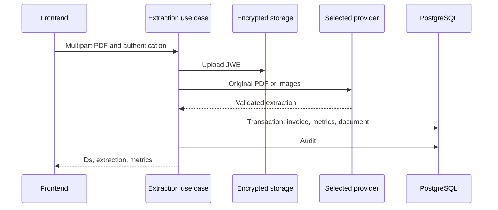

# Arquitectura y Flujo del Sistema

Recibe facturas eléctricas PDF, extrae campos mediante un proveedor multimodal, calcula indicadores y ofrece listas, dashboards, documentos y administración. Compare resultados con el PDF; validar el esquema no demuestra que los valores se hayan leído correctamente.

## Comportamiento implementado

TypeScript/NestJS 11 con Prisma 6.4/PostgreSQL, Passport/JWT, Argon2, Zod, S3 y JWE; frontend Next.js 16.1.6/React 19.2.3 con Redux Toolkit y TanStack Query. Módulos auth, invoices, llm, storage, audit, admin y health separan presentación, aplicación y contratos. El caso de uso depende de ILlmExtractor y DocumentStoragePort. El procesamiento es síncrono, sin cola de extracción.

## Archivos relacionados

- [backend/src/modules/invoices/application/process-invoice-extraction.use-case.ts](https://github.com/Vidigal-code/energy-bill-ai-parser/blob/00154f885896b294707fbf12ef0701a3d62630cd/backend/src/modules/invoices/application/process-invoice-extraction.use-case.ts)
- [backend/src/modules/invoices/domain/contracts/invoice-extraction.contract.ts](https://github.com/Vidigal-code/energy-bill-ai-parser/blob/00154f885896b294707fbf12ef0701a3d62630cd/backend/src/modules/invoices/domain/contracts/invoice-extraction.contract.ts)
- [backend/src/modules/llm/llm.module.ts](https://github.com/Vidigal-code/energy-bill-ai-parser/blob/00154f885896b294707fbf12ef0701a3d62630cd/backend/src/modules/llm/llm.module.ts)
- [backend/src/modules/invoices/presentation/invoices.controller.ts](https://github.com/Vidigal-code/energy-bill-ai-parser/blob/00154f885896b294707fbf12ef0701a3d62630cd/backend/src/modules/invoices/presentation/invoices.controller.ts)
- [backend/prisma/schema.prisma](https://github.com/Vidigal-code/energy-bill-ai-parser/blob/00154f885896b294707fbf12ef0701a3d62630cd/backend/prisma/schema.prisma)
- [docker-compose.yml](https://github.com/Vidigal-code/energy-bill-ai-parser/blob/00154f885896b294707fbf12ef0701a3d62630cd/docker-compose.yml)

## Navegación

- [Project guide](?menu=es&lang=es&id=19)
- [Source reference](?menu=es&lang=es&id=20)
