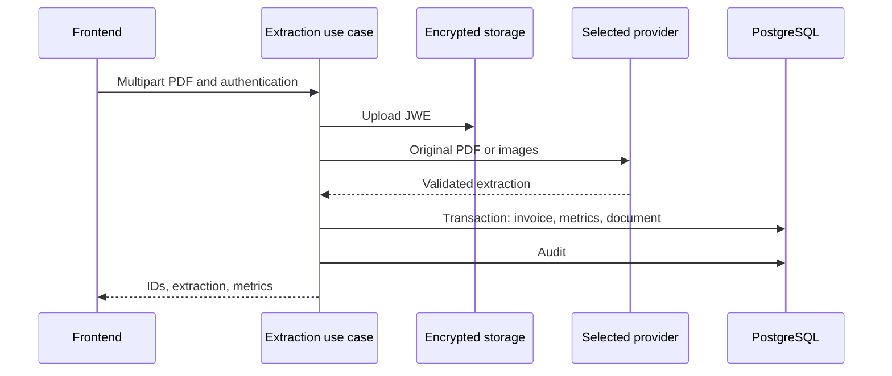

# energy-bill-ai-parser

Recibe facturas eléctricas PDF, extrae campos mediante un proveedor multimodal, calcula indicadores y ofrece listas, dashboards, documentos y administración. Compare resultados con el PDF; validar el esquema no demuestra que los valores se hayan leído correctamente.

## Comportamiento implementado

TypeScript/NestJS 11 con Prisma 6.4/PostgreSQL, Passport/JWT, Argon2, Zod, S3 y JWE; frontend Next.js 16.1.6/React 19.2.3 con Redux Toolkit y TanStack Query. Módulos auth, invoices, llm, storage, audit, admin y health separan presentación, aplicación y contratos. El caso de uso depende de ILlmExtractor y DocumentStoragePort. El procesamiento es síncrono, sin cola de extracción.



## Flujo y casos de fallo

1. Login/registro → tokens de acceso/refresh → JwtAuthGuard/RolesGuard. USER consulta sus datos por uploaderUserId; ADMIN tiene consultas administrativas. RefreshToken guarda hash, jti, caducidad, revocación y sustitución; refresh no es stateless. El inventario de controllers enumera rutas reales.

2. POST /api/invoices/extract recibe multipart file. Archivo ausente: 400; MIME distinto de application/pdf: 415; tamaño superior a PDF_MAX_FILE_SIZE_MB: 413. El archivo se cifra como JWE y sube a S3 antes de extraer. Comprobar MIME no equivale a inspeccionar todo el contenido.

3. OPEN_SOURCE_IA=true selecciona Ollama; en otro caso LLM_PROVIDER elige openai (predeterminado), gemini/google o claude. Usa adaptadores HTTP, no requiere SDK Gemini. Proveedores validan un contrato común; Ollama convierte PDF a imagen. Modelo/endpoint vienen de configuración. ROLLBACK_ON_INVOICE_FAILURE se lee/registra pero no desactiva la limpieza S3 del caso de uso actual.

4. Extracción válida → cálculo → transacción Prisma guarda Invoice SUCCESS, InvoiceMetrics y StoredDocument → AuditLog SUCCESS → respuesta con invoiceId, documentId, extraction y metrics. Consumo suma kWh eléctricos y SCEEE; compensada usa GD I; totalSinGD suma electricidad, SCEEE e iluminación; ahorro usa el valor GD I. No convierte automáticamente el ahorro a valor absoluto.

5. Un fallo dentro de extracción/persistencia intenta eliminar S3, audita error y propaga excepción. Fallo al eliminar registra warning. El upload inicial ocurre antes del bloque; fallo de auditoría después del commit puede dejar registros sin objeto. Existen enums PROCESSING/ERROR, pero no se crea una factura por cada intento fallido.

## Configuración y despliegue

Copie envexample.txt a .env; configure DATABASE_URL, proveedor/modelo/clave, S3 y cifrado. Compose inicia PostgreSQL, LocalStack y aplicaciones; Ollama opcional está comentado y no inicia automáticamente. Requiere dependencias de rasterización del Dockerfile y modelo de visión. Backend tiene test:unit/test:integration, lint/build; frontend lint/build. Ante 503 revise proveedor/clave; PDF rechazado formato/tamaño; dashboard vacío usuario/filtros/persistencia. Rutas reales incluyen dashboard/consolidated, energy, financial y my-documents.

## Comandos de ejecución

```sh
docker compose up --build
# Validation in a separately configured test environment
npm --prefix backend ci
npm --prefix backend run test:unit
npm --prefix backend run test:integration
npm --prefix backend run build
npm --prefix frontend ci
npm --prefix frontend run build
```

## Archivos relacionados

- [backend/src/modules/invoices/application/process-invoice-extraction.use-case.ts](https://github.com/Vidigal-code/energy-bill-ai-parser/blob/00154f885896b294707fbf12ef0701a3d62630cd/backend/src/modules/invoices/application/process-invoice-extraction.use-case.ts)
- [backend/src/modules/invoices/domain/contracts/invoice-extraction.contract.ts](https://github.com/Vidigal-code/energy-bill-ai-parser/blob/00154f885896b294707fbf12ef0701a3d62630cd/backend/src/modules/invoices/domain/contracts/invoice-extraction.contract.ts)
- [backend/src/modules/llm/llm.module.ts](https://github.com/Vidigal-code/energy-bill-ai-parser/blob/00154f885896b294707fbf12ef0701a3d62630cd/backend/src/modules/llm/llm.module.ts)
- [backend/src/modules/invoices/presentation/invoices.controller.ts](https://github.com/Vidigal-code/energy-bill-ai-parser/blob/00154f885896b294707fbf12ef0701a3d62630cd/backend/src/modules/invoices/presentation/invoices.controller.ts)
- [backend/prisma/schema.prisma](https://github.com/Vidigal-code/energy-bill-ai-parser/blob/00154f885896b294707fbf12ef0701a3d62630cd/backend/prisma/schema.prisma)
- [docker-compose.yml](https://github.com/Vidigal-code/energy-bill-ai-parser/blob/00154f885896b294707fbf12ef0701a3d62630cd/docker-compose.yml)

## Navegación

- [Project guide](?menu=es&lang=es&id=19)
- [Source reference](?menu=es&lang=es&id=20)
