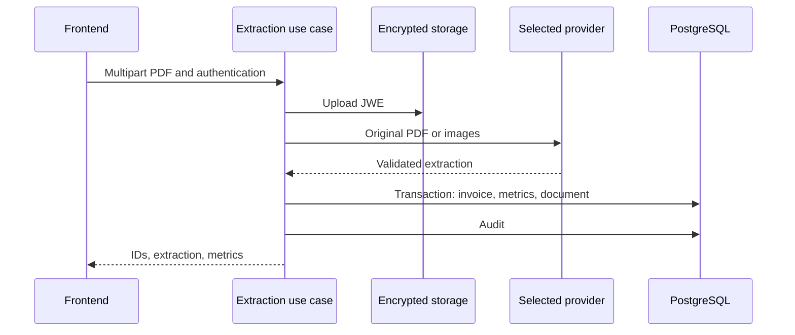

# energy-bill-ai-parser: Contexto y flujos del proyecto

GitPageDocs **0.0.24** · 1.0.0 · 2026-11-08

## Contexto

Recibe facturas eléctricas PDF, extrae campos mediante un proveedor multimodal, calcula indicadores y ofrece listas, dashboards, documentos y administración. Compare resultados con el PDF; validar el esquema no demuestra que los valores se hayan leído correctamente.

## Stack y arquitectura

TypeScript/NestJS 11 con Prisma 6.4/PostgreSQL, Passport/JWT, Argon2, Zod, S3 y JWE; frontend Next.js 16.1.6/React 19.2.3 con Redux Toolkit y TanStack Query. Módulos auth, invoices, llm, storage, audit, admin y health separan presentación, aplicación y contratos. El caso de uso depende de ILlmExtractor y DocumentStoragePort. El procesamiento es síncrono, sin cola de extracción.



## Flujos completos

1. Login/registro → tokens de acceso/refresh → JwtAuthGuard/RolesGuard. USER consulta sus datos por uploaderUserId; ADMIN tiene consultas administrativas. RefreshToken guarda hash, jti, caducidad, revocación y sustitución; refresh no es stateless. El inventario de controllers enumera rutas reales.

2. POST /api/invoices/extract recibe multipart file. Archivo ausente: 400; MIME distinto de application/pdf: 415; tamaño superior a PDF_MAX_FILE_SIZE_MB: 413. El archivo se cifra como JWE y sube a S3 antes de extraer. Comprobar MIME no equivale a inspeccionar todo el contenido.

3. OPEN_SOURCE_IA=true selecciona Ollama; en otro caso LLM_PROVIDER elige openai (predeterminado), gemini/google o claude. Usa adaptadores HTTP, no requiere SDK Gemini. Proveedores validan un contrato común; Ollama convierte PDF a imagen. Modelo/endpoint vienen de configuración. ROLLBACK_ON_INVOICE_FAILURE se lee/registra pero no desactiva la limpieza S3 del caso de uso actual.

4. Extracción válida → cálculo → transacción Prisma guarda Invoice SUCCESS, InvoiceMetrics y StoredDocument → AuditLog SUCCESS → respuesta con invoiceId, documentId, extraction y metrics. Consumo suma kWh eléctricos y SCEEE; compensada usa GD I; totalSinGD suma electricidad, SCEEE e iluminación; ahorro usa el valor GD I. No convierte automáticamente el ahorro a valor absoluto.

5. Un fallo dentro de extracción/persistencia intenta eliminar S3, audita error y propaga excepción. Fallo al eliminar registra warning. El upload inicial ocurre antes del bloque; fallo de auditoría después del commit puede dejar registros sin objeto. Existen enums PROCESSING/ERROR, pero no se crea una factura por cada intento fallido.

## Datos, seguridad y límites

Invoice vincula uploader, campos Decimal/JSON y métricas; StoredDocument guarda bucket/clave, checksum, tamaño y factura opcional; AuditLog guarda actor/acción/estado. Consultas filtran usuario/rol. Proteja claves LLM/cifrado y respalde las de cifrado. Cifrar S3 no impide enviar el PDF original al proveedor seleccionado. Backend determina autorización/valores.

## Ejecución, pruebas y operación

Copie envexample.txt a .env; configure DATABASE_URL, proveedor/modelo/clave, S3 y cifrado. Compose inicia PostgreSQL, LocalStack y aplicaciones; Ollama opcional está comentado y no inicia automáticamente. Requiere dependencias de rasterización del Dockerfile y modelo de visión. Backend tiene test:unit/test:integration, lint/build; frontend lint/build. Ante 503 revise proveedor/clave; PDF rechazado formato/tamaño; dashboard vacío usuario/filtros/persistencia. Rutas reales incluyen dashboard/consolidated, energy, financial y my-documents.

## Referencia completa

Dependencias, comandos, endpoints, variables, contratos y pruebas están en la [referencia del código](?menu=es&lang=es&id=20).

## Fuentes verificables

- [backend/src/modules/invoices/application/process-invoice-extraction.use-case.ts](https://github.com/Vidigal-code/energy-bill-ai-parser/blob/00154f885896b294707fbf12ef0701a3d62630cd/backend/src/modules/invoices/application/process-invoice-extraction.use-case.ts)

- [backend/src/modules/invoices/domain/contracts/invoice-extraction.contract.ts](https://github.com/Vidigal-code/energy-bill-ai-parser/blob/00154f885896b294707fbf12ef0701a3d62630cd/backend/src/modules/invoices/domain/contracts/invoice-extraction.contract.ts)

- [backend/src/modules/llm/llm.module.ts](https://github.com/Vidigal-code/energy-bill-ai-parser/blob/00154f885896b294707fbf12ef0701a3d62630cd/backend/src/modules/llm/llm.module.ts)

- [backend/src/modules/invoices/presentation/invoices.controller.ts](https://github.com/Vidigal-code/energy-bill-ai-parser/blob/00154f885896b294707fbf12ef0701a3d62630cd/backend/src/modules/invoices/presentation/invoices.controller.ts)

- [backend/prisma/schema.prisma](https://github.com/Vidigal-code/energy-bill-ai-parser/blob/00154f885896b294707fbf12ef0701a3d62630cd/backend/prisma/schema.prisma)

- [docker-compose.yml](https://github.com/Vidigal-code/energy-bill-ai-parser/blob/00154f885896b294707fbf12ef0701a3d62630cd/docker-compose.yml)

## Navegación de la documentación con GitPageDocs 0.0.24

Las opciones de esta sección requieren el runtime GitPageDocs **0.0.24**. La versión documental de este proyecto sigue siendo **1.0.0**. Actualizar texto y configuración no actualiza por sí solo el runtime publicado por el workflow.

### Índice por etiquetas

En `gitpagedocs/docs/versions/1.0.0/config.json`, cada elemento de `routes-md` utiliza `RouteguideBrand: true` y `RouteGuideTags: ["h1", "h2", "h3"]`. El índice incluye los tres primeros niveles de encabezados; los demás permanecen en el documento. Los nombres de propiedades distinguen mayúsculas y minúsculas.

```json
{ "RouteguideBrand": true, "RouteGuideTags": ["h1", "h2", "h3"] }
```

Omitir `RouteGuideTags` conserva el comportamiento anterior, de `h1` a `h6`. Una lista vacía (`[]`) elimina las entradas automáticas por etiqueta; los marcadores explícitos configurados en `markdownMarkers.items` todavía pueden formar parte del índice.

Para incluir otros elementos, añada nombres de etiquetas permitidas por el sanitizador, como `"p"`, `"blockquote"`, `"pre"`, `"table"`, `"img"`, `"details"` o `"summary"`. No hay comodines: `"*"`, las etiquetas peligrosas y las entradas inválidas se ignoran con un diagnóstico. Incluir `p`, `li`, `div` o `span` puede generar muchas entradas; seleccione solo las etiquetas útiles para la lectura.

Los rótulos usan título, texto alternativo o texto del elemento. Los elementos vacíos como `br`, `hr`, `img` e `input` pueden usar el nombre de la etiqueta. Los IDs automáticos son estables, únicos y separados por bloque. Utilice `markdownMarkers.items` para elegir una ocurrencia, definir un rótulo propio o aplicar un resaltado específico.

### Desplazamiento, pantallas pequeñas y plegables

Con el desplazamiento del índice desbloqueado, la entrada activa queda centrada, incluso al navegar con Anterior/Siguiente. El candado conserva la posición elegida manualmente en el índice. Esto permite consultar otra parte del índice sin que el seguimiento automático desplace la lista.

Al validar en un móvil, revise el menú contraído, las áreas táctiles, el foco del teclado, las tablas y los bloques de código con desplazamiento horizontal. En dispositivos plegables, repita la navegación con la pantalla plegada y abierta, en ambas orientaciones, y compruebe que la entrada activa siga accesible tras cambiar el ancho. Utilice el control de pausa cuando haya efectos animados y respete la preferencia de movimiento reducido.

GitPageDocs 0.0.24 utiliza `performance.mode: "auto"` para los efectos de los temas: reduce moderadamente la densidad en escritorio y utiliza un presupuesto menor por debajo de 768px, conservando las capas del tema. Las partículas ocultas se pausan y retoman la misma fase al cambiar el ancho. Para mantener la densidad completa, combine `site.backgroundEffects.overrides.performance: { "mode": "full" }` con `gitpagedocs/config.json`; la misma opción está disponible en `site.backgroundEffects.themes[themeId].performance`. Un override explícito de `layers` conserva la cantidad completa cuando no se define mode en los overrides. Seleccione `"auto"` explícitamente para aplicar el presupuesto también a las capas personalizadas.

## Familia de tema fija y modo claro/oscuro

`HideThemeSelector: true` oculta el selector completo de temas y mantiene la familia elegida por `ThemeDefault`. La alternancia claro/oscuro sigue disponible cuando esa familia tiene un par válido. Un tema diferente procedente de la URL o del almacenamiento del navegador no sustituye la familia fija.

`ThemeModeDefault` es el valor inicial de respaldo. Un modo válido en `modetheme=light` o `modetheme=dark` de la URL, un modo guardado o el botón del lector puede seleccionar claro/oscuro dentro de esa familia. El modo elegido se conserva al recargar y navegar entre documentos. En pantallas estrechas, abra Menu para acceder al control estándar. Sin un par válido, el control no aparece.

Las dos entradas del catálogo de layouts deben habilitar `supportsLightAndDarkModes`, compartir el mismo `supportsLightAndDarkModesReference` no vacío y declarar valores opuestos de `mode` (`light` y `dark`). Este proyecto utiliza el catálogo oficial con pares; conserve su familia y preferencias al actualizar los pins del runtime o de los layouts.
