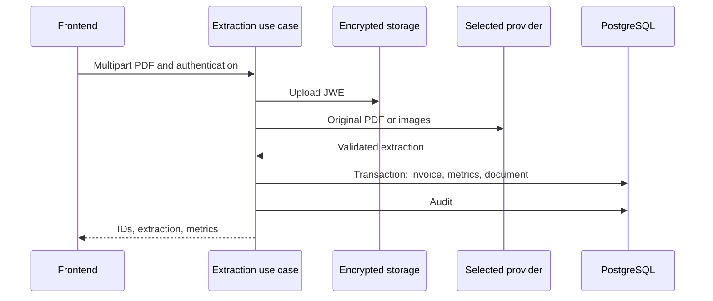

# Arquitetura e Fluxo do Sistema

Recebe faturas de energia em PDF, extrai campos estruturados por um provedor multimodal, calcula indicadores e oferece listagem, dashboards, documentos e administração. O resultado deve ser conferido contra o PDF original; validação de esquema não garante que os números foram lidos corretamente.

## Comportamento implementado

TypeScript/NestJS 11 com Prisma 6.4/PostgreSQL, Passport/JWT, Argon2, Zod, S3 e JWE; frontend Next.js 16.1.6/React 19.2.3 com Redux Toolkit e TanStack Query. Módulos auth, invoices, llm, storage, audit, admin e health separam apresentação, aplicação e contratos. O caso de uso depende de ILlmExtractor e DocumentStoragePort. O processamento é síncrono na requisição; não há fila de extração neste fluxo.

## Arquivos relacionados

- [backend/src/modules/invoices/application/process-invoice-extraction.use-case.ts](https://github.com/Vidigal-code/energy-bill-ai-parser/blob/00154f885896b294707fbf12ef0701a3d62630cd/backend/src/modules/invoices/application/process-invoice-extraction.use-case.ts)
- [backend/src/modules/invoices/domain/contracts/invoice-extraction.contract.ts](https://github.com/Vidigal-code/energy-bill-ai-parser/blob/00154f885896b294707fbf12ef0701a3d62630cd/backend/src/modules/invoices/domain/contracts/invoice-extraction.contract.ts)
- [backend/src/modules/llm/llm.module.ts](https://github.com/Vidigal-code/energy-bill-ai-parser/blob/00154f885896b294707fbf12ef0701a3d62630cd/backend/src/modules/llm/llm.module.ts)
- [backend/src/modules/invoices/presentation/invoices.controller.ts](https://github.com/Vidigal-code/energy-bill-ai-parser/blob/00154f885896b294707fbf12ef0701a3d62630cd/backend/src/modules/invoices/presentation/invoices.controller.ts)
- [backend/prisma/schema.prisma](https://github.com/Vidigal-code/energy-bill-ai-parser/blob/00154f885896b294707fbf12ef0701a3d62630cd/backend/prisma/schema.prisma)
- [docker-compose.yml](https://github.com/Vidigal-code/energy-bill-ai-parser/blob/00154f885896b294707fbf12ef0701a3d62630cd/docker-compose.yml)

## Navegação

- [Project guide](?menu=pt&lang=pt&id=19)
- [Source reference](?menu=pt&lang=pt&id=20)
