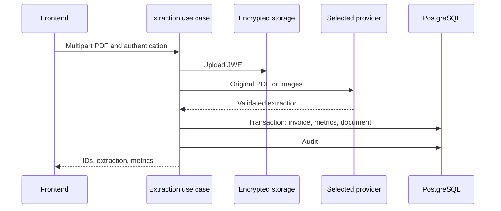

# energy-bill-ai-parser

Recebe faturas de energia em PDF, extrai campos estruturados por um provedor multimodal, calcula indicadores e oferece listagem, dashboards, documentos e administração. O resultado deve ser conferido contra o PDF original; validação de esquema não garante que os números foram lidos corretamente.

## Comportamento implementado

TypeScript/NestJS 11 com Prisma 6.4/PostgreSQL, Passport/JWT, Argon2, Zod, S3 e JWE; frontend Next.js 16.1.6/React 19.2.3 com Redux Toolkit e TanStack Query. Módulos auth, invoices, llm, storage, audit, admin e health separam apresentação, aplicação e contratos. O caso de uso depende de ILlmExtractor e DocumentStoragePort. O processamento é síncrono na requisição; não há fila de extração neste fluxo.



## Fluxo e casos de falha

1. Login/cadastro → access token e refresh token → JwtAuthGuard/RolesGuard. USER consulta dados do próprio uploaderUserId; ADMIN possui consultas administrativas. RefreshToken armazena hash, jti, expiração, revogação e substituição; não documente o refresh como token sem estado. O inventário de controllers informa todas as rotas reais.

2. POST /api/invoices/extract recebe multipart no campo file. Arquivo ausente retorna 400; MIME diferente de application/pdf retorna 415; tamanho acima de PDF_MAX_FILE_SIZE_MB retorna 413. O arquivo é criptografado em JWE e enviado ao S3 antes da chamada ao extrator. A validação de MIME usada pelo caso de uso não equivale a inspeção completa de conteúdo.

3. OPEN_SOURCE_IA=true seleciona Ollama; caso contrário LLM_PROVIDER seleciona openai (padrão), gemini/google ou claude. O módulo usa adaptadores com HTTP, não um SDK Gemini obrigatório. Provedores validam a saída pelo contrato comum; Ollama usa conversão PDF/imagem. Modelo e endpoint vêm da configuração. ROLLBACK_ON_INVOICE_FAILURE é lido/logado no módulo, mas não desliga a limpeza do S3 no caso de uso atual.

4. Extração válida → cálculo → transação Prisma grava Invoice SUCCESS, InvoiceMetrics e StoredDocument → AuditLog SUCCESS → resposta com invoiceId, documentId, extraction e metrics. Consumo soma kWh de Energia Elétrica e SCEEE; compensada usa GD I; totalSemGD soma valores de Energia Elétrica, SCEEE e iluminação; economia usa valor de GD I. Não há conversão absoluta automática do sinal da economia.

5. Falha dentro do bloco de extração/persistência tenta remover o objeto S3, registra auditoria de erro e propaga a exceção. Falha de remoção gera warning. Upload inicial ocorre antes desse bloco; erro de auditoria após commit pode deixar registros persistidos com objeto removido. Os enums PROCESSING/ERROR existem no schema, mas este caso de uso não cria uma linha de fatura para cada tentativa malsucedida.

## Configuração e implantação

Copie envexample.txt para .env; configure DATABASE_URL, provedor/modelo, chave correspondente, S3 e criptografia. Compose inicia PostgreSQL, LocalStack, backend e frontend; Ollama tem configuração opcional comentada, não presuma que inicia automaticamente. Para Ollama instale as dependências de rasterização do Dockerfile e disponibilize modelo de visão. Backend tem test:unit/test:integration, lint e build; frontend tem lint/build. Em 503 confira provedor/chave; em PDF inválido confira formato/limite; em dashboard vazio confira usuário, filtros e persistência. Os endpoints reais incluem dashboard/consolidated, energy, financial e my-documents.

## Comandos de execução

```sh
docker compose up --build
# Validation in a separately configured test environment
npm --prefix backend ci
npm --prefix backend run test:unit
npm --prefix backend run test:integration
npm --prefix backend run build
npm --prefix frontend ci
npm --prefix frontend run build
```

## Arquivos relacionados

- [backend/src/modules/invoices/application/process-invoice-extraction.use-case.ts](https://github.com/Vidigal-code/energy-bill-ai-parser/blob/00154f885896b294707fbf12ef0701a3d62630cd/backend/src/modules/invoices/application/process-invoice-extraction.use-case.ts)
- [backend/src/modules/invoices/domain/contracts/invoice-extraction.contract.ts](https://github.com/Vidigal-code/energy-bill-ai-parser/blob/00154f885896b294707fbf12ef0701a3d62630cd/backend/src/modules/invoices/domain/contracts/invoice-extraction.contract.ts)
- [backend/src/modules/llm/llm.module.ts](https://github.com/Vidigal-code/energy-bill-ai-parser/blob/00154f885896b294707fbf12ef0701a3d62630cd/backend/src/modules/llm/llm.module.ts)
- [backend/src/modules/invoices/presentation/invoices.controller.ts](https://github.com/Vidigal-code/energy-bill-ai-parser/blob/00154f885896b294707fbf12ef0701a3d62630cd/backend/src/modules/invoices/presentation/invoices.controller.ts)
- [backend/prisma/schema.prisma](https://github.com/Vidigal-code/energy-bill-ai-parser/blob/00154f885896b294707fbf12ef0701a3d62630cd/backend/prisma/schema.prisma)
- [docker-compose.yml](https://github.com/Vidigal-code/energy-bill-ai-parser/blob/00154f885896b294707fbf12ef0701a3d62630cd/docker-compose.yml)

## Navegação

- [Project guide](?menu=pt&lang=pt&id=19)
- [Source reference](?menu=pt&lang=pt&id=20)
