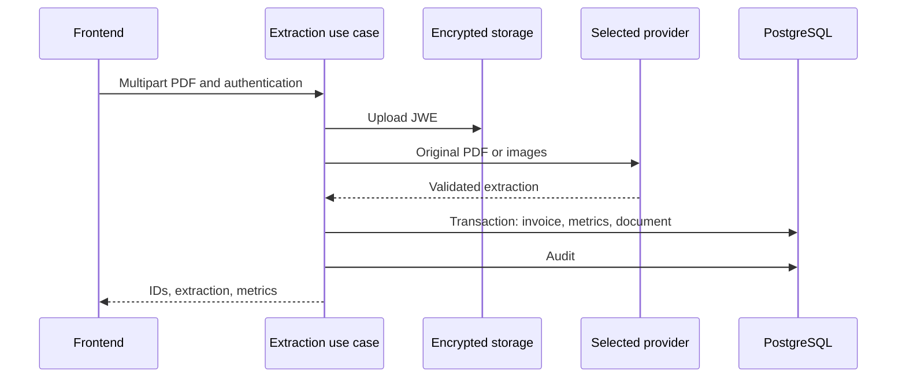

# energy-bill-ai-parser: Contexto e fluxos do projeto

GitPageDocs **0.0.30** · 1.0.0 · 2026-11-24

## Contexto

Recebe faturas de energia em PDF, extrai campos estruturados por um provedor multimodal, calcula indicadores e oferece listagem, dashboards, documentos e administração. O resultado deve ser conferido contra o PDF original; validação de esquema não garante que os números foram lidos corretamente.

## Stack e arquitetura

TypeScript/NestJS 11 com Prisma 6.4/PostgreSQL, Passport/JWT, Argon2, Zod, S3 e JWE; frontend Next.js 16.1.6/React 19.2.3 com Redux Toolkit e TanStack Query. Módulos auth, invoices, llm, storage, audit, admin e health separam apresentação, aplicação e contratos. O caso de uso depende de ILlmExtractor e DocumentStoragePort. O processamento é síncrono na requisição; não há fila de extração neste fluxo.



## Fluxos completos

1. Login/cadastro → access token e refresh token → JwtAuthGuard/RolesGuard. USER consulta dados do próprio uploaderUserId; ADMIN possui consultas administrativas. RefreshToken armazena hash, jti, expiração, revogação e substituição; não documente o refresh como token sem estado. O inventário de controllers informa todas as rotas reais.

2. POST /api/invoices/extract recebe multipart no campo file. Arquivo ausente retorna 400; MIME diferente de application/pdf retorna 415; tamanho acima de PDF_MAX_FILE_SIZE_MB retorna 413. O arquivo é criptografado em JWE e enviado ao S3 antes da chamada ao extrator. A validação de MIME usada pelo caso de uso não equivale a inspeção completa de conteúdo.

3. OPEN_SOURCE_IA=true seleciona Ollama; caso contrário LLM_PROVIDER seleciona openai (padrão), gemini/google ou claude. O módulo usa adaptadores com HTTP, não um SDK Gemini obrigatório. Provedores validam a saída pelo contrato comum; Ollama usa conversão PDF/imagem. Modelo e endpoint vêm da configuração. ROLLBACK_ON_INVOICE_FAILURE é lido/logado no módulo, mas não desliga a limpeza do S3 no caso de uso atual.

4. Extração válida → cálculo → transação Prisma grava Invoice SUCCESS, InvoiceMetrics e StoredDocument → AuditLog SUCCESS → resposta com invoiceId, documentId, extraction e metrics. Consumo soma kWh de Energia Elétrica e SCEEE; compensada usa GD I; totalSemGD soma valores de Energia Elétrica, SCEEE e iluminação; economia usa valor de GD I. Não há conversão absoluta automática do sinal da economia.

5. Falha dentro do bloco de extração/persistência tenta remover o objeto S3, registra auditoria de erro e propaga a exceção. Falha de remoção gera warning. Upload inicial ocorre antes desse bloco; erro de auditoria após commit pode deixar registros persistidos com objeto removido. Os enums PROCESSING/ERROR existem no schema, mas este caso de uso não cria uma linha de fatura para cada tentativa malsucedida.

## Dados, segurança e limites

Invoice vincula uploader, campos extraídos em Decimal/JSON e métricas; StoredDocument guarda bucket/chave, checksum, tamanho e vínculo opcional; AuditLog guarda ator/ação/status. Consultas filtram usuário e papel. Proteja chaves de LLM e de criptografia e mantenha backup dessas chaves para recuperar arquivos. Criptografia em repouso no S3 não impede que o PDF original seja enviado ao provedor escolhido. A UI separa estado local do cache de requisições; o backend determina autorização e valores.

## Execução, testes e operação

Copie envexample.txt para .env; configure DATABASE_URL, provedor/modelo, chave correspondente, S3 e criptografia. Compose inicia PostgreSQL, LocalStack, backend e frontend; Ollama tem configuração opcional comentada, não presuma que inicia automaticamente. Para Ollama instale as dependências de rasterização do Dockerfile e disponibilize modelo de visão. Backend tem test:unit/test:integration, lint e build; frontend tem lint/build. Em 503 confira provedor/chave; em PDF inválido confira formato/limite; em dashboard vazio confira usuário, filtros e persistência. Os endpoints reais incluem dashboard/consolidated, energy, financial e my-documents.

## Referência completa

Dependências, comandos, endpoints, variáveis, contratos e testes estão na [referência do código](?menu=pt&lang=pt&id=20).

## Fontes verificáveis

- [backend/src/modules/invoices/application/process-invoice-extraction.use-case.ts](https://github.com/Vidigal-code/energy-bill-ai-parser/blob/00154f885896b294707fbf12ef0701a3d62630cd/backend/src/modules/invoices/application/process-invoice-extraction.use-case.ts)

- [backend/src/modules/invoices/domain/contracts/invoice-extraction.contract.ts](https://github.com/Vidigal-code/energy-bill-ai-parser/blob/00154f885896b294707fbf12ef0701a3d62630cd/backend/src/modules/invoices/domain/contracts/invoice-extraction.contract.ts)

- [backend/src/modules/llm/llm.module.ts](https://github.com/Vidigal-code/energy-bill-ai-parser/blob/00154f885896b294707fbf12ef0701a3d62630cd/backend/src/modules/llm/llm.module.ts)

- [backend/src/modules/invoices/presentation/invoices.controller.ts](https://github.com/Vidigal-code/energy-bill-ai-parser/blob/00154f885896b294707fbf12ef0701a3d62630cd/backend/src/modules/invoices/presentation/invoices.controller.ts)

- [backend/prisma/schema.prisma](https://github.com/Vidigal-code/energy-bill-ai-parser/blob/00154f885896b294707fbf12ef0701a3d62630cd/backend/prisma/schema.prisma)

- [docker-compose.yml](https://github.com/Vidigal-code/energy-bill-ai-parser/blob/00154f885896b294707fbf12ef0701a3d62630cd/docker-compose.yml)

## Navegação da documentação com GitPageDocs 0.0.30

Este guia descreve o runtime GitPageDocs **0.0.30**. A versão documental deste projeto continua **1.0.0**. Atualizar o texto e a configuração não atualiza, por si só, o runtime publicado pelo workflow.

### Índice por tags

Em `gitpagedocs/docs/versions/1.0.0/config.json`, cada item de `routes-md` usa `RouteguideBrand: true` e `RouteGuideTags: ["h1", "h2", "h3"]`. O índice mantém os três primeiros níveis de títulos; os demais títulos continuam no documento. A grafia das propriedades diferencia maiúsculas e minúsculas.

```json
{ "RouteguideBrand": true, "RouteGuideTags": ["h1", "h2", "h3"] }
```

Omitir `RouteGuideTags` preserva o comportamento legado, com `h1` até `h6`. Uma lista vazia (`[]`) remove as entradas automáticas por tag; marcadores explícitos configurados em `markdownMarkers.items` ainda podem compor o índice.

Para incluir outros elementos, acrescente nomes de tags permitidas pelo sanitizador, por exemplo `"p"`, `"blockquote"`, `"pre"`, `"table"`, `"img"`, `"details"` ou `"summary"`. Não existe curinga: `"*"`, tags perigosas e entradas inválidas são ignorados com diagnóstico. Incluir `p`, `li`, `div` ou `span` pode gerar muitas entradas; prefira somente as tags úteis para a leitura.

Os rótulos usam título, texto alternativo ou texto do elemento. Elementos vazios como `br`, `hr`, `img` e `input` podem usar o nome da tag. IDs automáticos são estáveis, únicos e separados por bloco. Use `markdownMarkers.items` quando precisar escolher uma ocorrência, definir rótulo próprio ou aplicar um destaque específico.

### Rolagem, telas pequenas e dobráveis

Com a rolagem do índice desbloqueada, o item ativo é centralizado, inclusive ao navegar por Anterior/Próximo. O cadeado preserva a posição escolhida manualmente no índice. Isso permite consultar outra parte do índice sem que o acompanhamento automático reposicione a lista.

Ao validar em celular, confira o menu recolhido, alvos de toque, foco por teclado, tabelas e blocos de código com rolagem horizontal. Em dispositivos dobráveis, repita a navegação com a tela dobrada e aberta, nas duas orientações, e confirme que o item ativo permanece acessível após a mudança de largura. Use o controle de pausa quando houver efeitos animados e respeite a preferência de movimento reduzido.

O GitPageDocs 0.0.30 usa `performance.mode: "auto"` nos efeitos dos temas: reduz moderadamente a densidade no desktop e usa um orçamento menor abaixo de 768px, mantendo as camadas do tema. Partículas ocultas ficam pausadas e retomam a mesma fase ao mudar a largura. Para manter a densidade completa, mescle `site.backgroundEffects.overrides.performance: { "mode": "full" }` em `gitpagedocs/config.json`; a mesma opção pode ser definida em `site.backgroundEffects.themes[themeId].performance`. Um override explícito de `layers` mantém a contagem completa quando não há mode definido nos overrides. Use `"auto"` explicitamente para aplicar o orçamento também às camadas personalizadas.

## Família de tema fixa e modo claro/escuro

`HideThemeSelector: true` oculta o seletor completo de temas e mantém a família escolhida por `ThemeDefault`. A alternância claro/escuro continua disponível quando essa família possui um par válido. Um tema diferente vindo da URL ou do armazenamento do navegador não substitui a família fixa.

`ThemeModeDefault` é o fallback inicial. Um modo válido em `modetheme=light` ou `modetheme=dark` na URL, um modo salvo ou o botão do leitor pode selecionar claro/escuro dentro dessa família. O modo escolhido permanece após recarregar e navegar entre documentos. Em telas estreitas, abra Menu para acessar o controle padrão. Sem um par válido, o controle não aparece.

As duas entradas do catálogo de layouts devem habilitar `supportsLightAndDarkModes`, compartilhar o mesmo `supportsLightAndDarkModesReference` não vazio e declarar valores opostos de `mode` (`light` e `dark`). Este projeto usa o catálogo oficial com pares; preserve sua família e preferências ao atualizar os pins do runtime ou dos layouts.

## Altura do guia lateral desktop

Em telas desktop com mais de 1024 pixels CSS, o guia lateral termina após o último item, sem se estender até o fim do artigo. Desde a 0.0.25, ele pode crescer até a altura disponível da janela abaixo do cabeçalho antes de precisar de rolagem interna. Esse layout lateral tem prioridade sobre `TocScrollMaxHeightDesktop`; o guia centralizado acima do conteúdo e os layouts de até 1024 pixels mantêm suas regras anteriores de dimensionamento. Uma pequena barra na cor do item ativo acompanha a seção marcada durante a rolagem. O indicador usa o acompanhamento de seções existente, sem animação contínua. No GitPageDocs 0.0.26, os guias laterais ganham mais 0.5rem de espaço abaixo do cabeçalho (8px com a fonte raiz padrão) e mantêm 1rem abaixo do cartão no limite da viewport. Esse ajuste vale somente acima de 1024 pixels CSS; os layouts menores são preservados.

## Leitura e controles no GitPageDocs 0.0.29

- **0.0.27 — código-fonte:** quando há um contêiner Source code configurado, listas longas de arquivos e prévias rolam dentro dele, limitado à altura disponível da janela. A atualização do runtime não adiciona essa rota automaticamente.
- **0.0.28 — guia do documento:** o espaço entre os itens e a barra de rolagem é de 1.5rem (24 pixels CSS com a fonte raiz padrão). Em Chromium/WebKit compatíveis, a barra lateral tem 4px, trilho transparente e indicador discreto na cor do tema; outros navegadores usam a barra fina nativa, conforme suporte e preferências de acessibilidade.
- **0.0.29 — navegação do Markdown:** Anterior, Próximo e Voltar ao topo ficam dentro do contêiner, após o conteúdo, com 8px de separação no fluxo normal. O texto, tabelas e demais elementos não ficam cobertos. Os controles seguem o padrão visual de copiar/baixar: 36 × 36px no desktop, 6px entre botões e altura mínima de 44px em dispositivos com ponteiro de toque. O botão de topo continua condicionado às opções de `site.backToTop` e à altura da página.

O alinhamento continua configurável em `gitpagedocs/config.json`, por `site.documentNavigation.position`: `left`, `center` ou `right`. Este projeto mantém `center`. O modo foco usa o olho enquadrado `LuScanEye`, distinto de tela cheia; o rótulo acessível permanece disponível e ícones personalizados continuam aceitos em `site.icons.FocusMode`.

Ao validar, abra documentos longos e curtos, navegue até o primeiro e o último, confira os limites desabilitados e use Tab/Enter para voltar ao topo. Repita em desktop e tela de toque, nos três alinhamentos. A versão dos documentos da aplicação continua `1.0.0`.

## Arquivos de código fonte e navegação da árvore no GitPageDocs 0.0.30

Desde a 0.0.30, Código fonte reconhece arquivos UTF-16LE e UTF-16BE pela marca de ordem de bytes (BOM). O visualizador remove a marca inicial e preserva acentos, texto de alfabetos não latinos e emoji. Arquivos sem BOM de UTF-16 continuam sendo decodificados como UTF-8, incluindo arquivos UTF-8 com BOM. Isso corrige a exibição de arquivos como um `.gitignore` em UTF-16 sem alterar o arquivo do repositório.

A árvore de arquivos permite rolagem horizontal e vertical e exibe os nomes completos de arquivos e pastas. Clicar na linha de uma pasta expande ou recolhe seus itens sem trocar o arquivo aberto nem o endereço atual. A listagem central, os caminhos de navegação e os resultados de pastas filtrados continuam permitindo navegar pelos diretórios. Confira nomes longos e pastas com vários níveis nas duas direções de rolagem; abrir e fechar uma pasta repetidamente deve preservar o arquivo selecionado e o endereço.

O visualizador não tenta adivinhar a codificação de arquivos UTF-16 sem BOM nem adiciona rotas de Código fonte automaticamente. Onde essa visualização estiver configurada, abra um `.gitignore` UTF-16 válido pela lista de diretórios e confira se `node_modules/` está legível. Confira também nomes ou conteúdos de arquivo com acentos, emoji e a volta ao diretório no desktop e no celular. A versão documental continua `1.0.0`.
